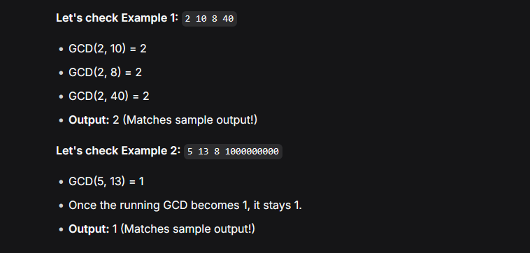

There are N monsters, numbered 1, 2, ..., M
Initially, the health of Monster i -> is A[i]
Below, a monster with at least 1 health -> is called alive

until there is only 1 alive monster, the following is repeated:
    + a random alive monster -> attacks another random alive monster
    + as a result, the health of the monster attacked is reduced by the amount equal to the current health of the monster attacking.

find the minimum possible final health of the last monster alive.

Constraints

    All values in input are integers.
    2≤ N ≤ 10^5
    1 ≤ Ai ​≤ 10^9

Input

Input is given from Standard Input in the following format:

N
A1​ A2​ ... AN​

Output

Print the minimum possible final health of the last monster alive.

Sample Input 1
4
2 10 8 40

Sample Output 1
2

When only the first monster keeps on attacking, the final health of the last monster will be 2, which is minimum.

Sample Input 2

4
5 13 8 1000000000

Sample Output 2

1

Sample Input 3

3
1000000000 1000000000 1000000000

Sample Output 3

1000000000

1. The "Aha!" Moment: The euclidean algorithm

    Sample Input 1
    4
    2 10 8 40

    Sample Output 1
    2

    -> look at what happens when Monster A (health = 10) attacks Monster B (health = 8)
        -> B health becomes 8 - 10 = -2 -> Monster B dies

    Wait, the problem says "health is reduced by". So if A attacks B, B becomes 8−10=−2 (dead). But what if B attacks A? A becomes 10−8=2

    Let's trace Monster A (10) and Monster B (8):

    B attacks A: A becomes 2.

    A (2) attacks B (8): B becomes 6.

    A (2) attacks B (6): B becomes 4.

    A (2) attacks B (4): B becomes 2.

    A (2) attacks B (2): B becomes 0 (B dies). A survives with 2 health.

Look at that result: 2. What is the Greatest Common Divisor (GCD) of 10 and 8? It's 2!

    -> Whenever two monsters fight until one dies, the survivor's health will always be the GCD of their initial healths. The attack mechanic (b = b - a) is exactly how the Euclidean algorithm works mathematically.

    2. Extending to N Monsters

        If you have many monsters, they can all attack the same monster, or fight each other. But no matter what order they fight in, the final surviving health will always be a multiple of the GCD of the entire array.

        To get the minimum possible final health, we want to reduce it as much as possible. By carefully choosing who attacks whom, we can always force the final survivor's health to be exactly:
        GCD(A1,A2,A3,…,AN)

        