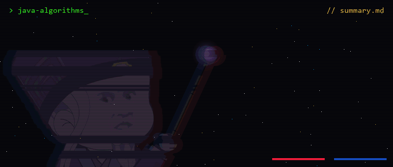

<div align="center">
  
</div>

<p align="center">Java OOP & algorithm study notes — one chunk per problem: idea → walkthrough → full solution.</p>

<p align="center">
  
  
</p>

---

## 📚 Notes

Everything lives in **[summary.md](summary.md)**: each problem has the key idea, a step-by-step walkthrough and the full solution.

| # | Problem | Topic |
|---|---|---|
| 1 | [J04006 — Khai báo lớp sinh viên](summary.md#j04006) | OOP · Encapsulation |
| 2 | [J04007 — Khai báo lớp nhân viên](summary.md#j04007) | OOP · I/O |
| 3 | [J04012 — Tính công](summary.md#j04012) | OOP |
| 4 | [Sản phẩm (SanPham)](summary.md#sanpham) | OOP · static counter |
| 5 | [Đa thức (DaThuc)](summary.md#dathuc) | Arrays · Math |
| 6 | [MyFunction](summary.md#myfunction) | String · HashMap |
| 7 | [Người công (NguoiCong / QLNC)](summary.md#nguoicong) | OOP · static counter |
| 8 | [Nhân viên (NhanVien)](summary.md#nhanvien) | OOP · String |
| 9 | [JKT014 — Đầu tư chứng khoán](summary.md#jkt014) | Monotonic stack |
| 10 | [J08010 — Tìm từ thuận nghịch dài nhất](summary.md#j08010) | String · Sorting |
| 11 | [J08011 — Liệt kê và đếm](summary.md#j08011) | HashMap · Sorting |
| 12 | [Đếm cặp có tổng bằng k](summary.md#pair-sum-k) | Binary search |
| 13 | [Kiểm tra dãy ngoặc hợp lệ](summary.md#valid-brackets) | Stack |
| 14 | [AtCoder ABC118 C — Monsters Battle Royale](summary.md#atcoder-monsters) | Math · GCD |

## 🧩 Topics

`OOP` `Encapsulation` `HashMap` `Sorting` `Stack` `Monotonic stack` `Binary search` `GCD`

## 🎬 Rebuild the banner

The wizard is the purple avatar from [kkdoestech/kkdoestech](https://github.com/kkdoestech/kkdoestech); the sleeve, hand and staff are drawn by the script.

```bash
pip install pillow
python tools/make_intro.py
```
