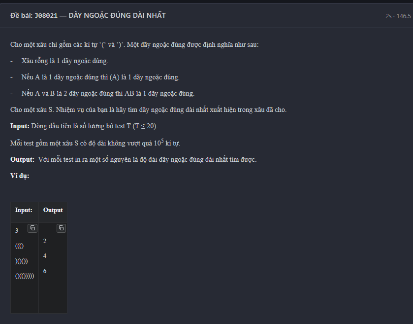

Longest Valid Parentheses problem.

1. The Core Concept (The "Why")
    we want to find the length of the longest valid parentheses sequence.
        + The Stack (Stack<Integer> a) : we use the stack -> to store indices (positions) of the characters.
            -> it helps us keep track of the most recent unmatched '(' or unmatched ')'

        + The DP Array (int dp[]): dp[i] -> stores the length of the longest valid parentheses substring that ends exactly at index i.
            + if the character at index i -> is '(' -> it cannot be the end of a valid sequence -> dp[i] = 0
            + if it's ')' -> it might close a valid sequence.

2. Line-by-line

    int dp[] = new int[s.length()];
    int ans = 0;
    Stack<Integer> a = new Stack<>();

    for (int i = 0; i < s.length(); ++i) {
        // if the stack is empty -> just push the current index
        if (a.empty()) a.push(i);
        else {
            // check if the current ')' matches the '(' at the top of the stack
            if (s.charAt(i) == ')' && s.charAt(a.lastElement()) == '(') {
                // 1. calculate the length of this basic pair
                dp[i] = i - a.lastElement() + 1;

                // 2. check if there is a valid sequence immediately BEFORE this pair
                if (a.lastElement() > 0 && s.charAt(a.lastElement() - 1) == ')') {
                    dp[i] += dp[a.lastElement() - 1];
                }

                // 3. update the maximum answer
                ans = Math.max(ans, dp[i]);

                // 4. we found a match, pop the '(' index from the stack
                a.pop();
            }
            else {
                // if it's a '(' or an unmatched ')' -> push its index onto the stack
                a.push(i);
            }
        }
    }

        + a.lastElement(): this is a method  -> we only have a match if current character is ')' and the character at the top of the stack -> is '('

    The Clever DP Transition:
        if (a.lastElement() > 0 && s.charAt(a.lastElement() - 1) == ')') {
            dp[i] += dp[a.lastElement() - 1];
        }

            -> imagine the string is ()() -> when we reach the last ) -> (index 3):
                1. it matches the ( -> at index 2
                2. dp[3] -> becomes 3 - 2 + 1 = 2 -> () at the end
                3. but look at a.lastElement() - 1 -> which is index 1 -> it's a ')' -> dp[1] is 2
                4. we add dp[1] to dp[3] -> making dp[3] = 2 + 2 = 4

import java.util.*;
import java.io.*;

public class Main {
    public static void main(String[] args) throws IOException, ClassNotFoundException {
        Scanner sc = new Scanner(System.in);
        int t = sc.nextInt();
        while (t-- > 0) {
            String s = sc.next();
            int dp[] = new int[s.length()];
            int ans = 0;
            Stack<Integer> a = new Stack<>();
            for (int i = 0; i < s.length(); ++i) {
                if (a.empty()) a.push(i);
                else {
                    if (s.charAt(i) == ')' && s.charAt(a.lastElement()) == '(') {
                        dp[i] = i - a.lastElement() + 1;
                        if (a.lastElement() > 0 && s.charAt(a.lastElement() - 1) == ')') {
                            dp[i] += dp[a.lastElement() - 1];
                        }
                        ans = Math.max(ans, dp[i]);
                        a.pop();
                    }
                    else a.push(i);
                }
            }
            System.out.println(ans);
        }
    }
}

