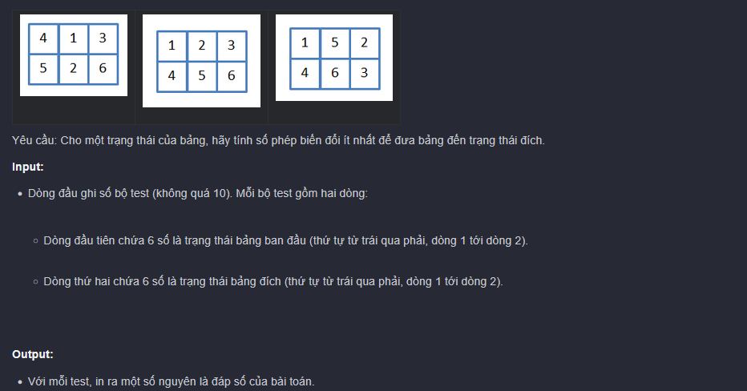
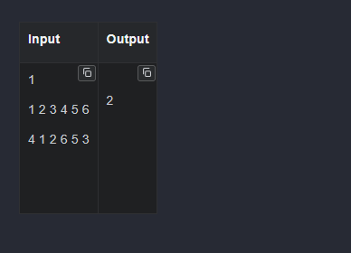

có 1 chiếc bảng hình chữ nhật với 6 miếng ghép, trên mỗi miếng ghép được điền 1 số nguyên trong khoảng 1 đến 6.
    tại mỗi bước, chọn 1 hình vuông (bên trái or bên phải) rồi quay theo chiều đồng hồ.
    

    

    -> giải:

    dùng BFS

    1. The Core concept: the "maze" of states
        imagine a 2x3 grid. it has exactly 6! = 720 possible arrangements of the numbers 1 to 6.
            + The state: the current arrangement of the 6 numbers
            + The Moves: you can either rotate the left 2x2 square or right 2x2 square
            + The goal: find the shortest sequence of moves to reach the target arrangement.

        Since every state has at most 2 possible moves, this forms a tree (or a graph).
            -> BFS explores this graph level by level
                -> it checks all states that are 1 step away, then all states that are 2 steps away, and so on. 
                    -> the first time it sees the target, it guaranteed to be the shortest path.

    2. Line-by-line code
        The Helper Class: (pair)
            state class pair {
                int[] a;
                int cnt;
                public pair(int[] a, int cnt) {
                    this.a = a;
                    this.cnt = cnt;
                }
            }

                + since we need to keep track of both the grid configuration (a) and the number of steps taken (cnt), we bundle them together in a custom class.
                + (a) -> is a 1D array of size 6 -> representing the 2x3 grid
                    eg: [1, 2, 3, 4, 5, 6]

        The Rotation Logic: (turn) (the trickiest part)
            static int[] turn(int[] pair, int start) {
                int[] a = new int[6];
                // 1. create a COPY of the array
                for (int i = 0; i < 6; ++i) a[i] = arr[i];
            }

                -> Why copy? -> if we modify (arr) directly -> we destroy the current state -> BFS needs to keep the current state intact while generating new ones.
                -> Let's map the indices: Top row is 0, 1, 2. bottom row is 3, 4, 5

                int x = a[start];
                a[start] = a[start + 3];
                a[start + 3] = a[start + 4];
                a[start + 4] = a[start + 1];
                a[start + 1] = x;
                return a;

                    -> if start = 0 (left sqare) -> The indices involved are 0, 1 (top) and 3, 4 (bottom).

                    If start = 1 (Right Square): The indices are 1, 2 (top) and 4, 5 (bottom). The same logic applies to shift them clockwise.

        The main logic: BFS
            Queue<pair> q = new LinkedList<>();
            q.add(new pair(s, 0));

                -> we use a (Queue) for BFS. -> think of it like a line at a supermarket: First In, First Out (FIFO)
                    -> we put the initial state (s) into the queue with (cnt = 0)

                while (!q.empty()) {
                    pair u = q.poll();  // take the state at front of line

                    if (check(t, u.a)) {
                        System.out.println(u.cnt);
                        break;
                    }

                    q.add(new pair(turn(u.a, 0), u.cnt+1));
                    q.add(new pair(turn(u.a, 1), u.cnt+1));

                       
                }

                    -> check(t, u.a): is this our target -> if yes, print the steps (u.cnt) and break
                    + if not -> we generate the next states: rotate left(turn(u.a, 0)) and rotate right -> turn(u.a,1)
                    -> we add them to the queue with u.cnt + 1 steps

import java.util.*;

public class non {
    static class pair {
        int[] a; 
        int cnt;
        public pair(int[] a, int cnt) {
            this.a = a;
            this.cnt = cnt;
        }
    }

    static int[] turn(int[] arr, int start) {
        int[] a = new int[6];
        for (int i = 0; i < 6; ++i) a[i] = arr[i];
        int x = a[start];
        a[start] = a[start + 3];
        a[start + 3] = a[start + 4];
        a[start + 4] = a[start + 1];
        a[start + 1] = x;
        return a;
    }

    static boolean check(int[] a, int[] b) {
        for (int i = 0; i < 6; ++i) if (a[i] != b[i]) return false;
        return true;
    }

    public static void main(String[] args) {
        Scanner sc = new Scanner(System.in);
        int T = sc.nextInt();
        while (T-- > 0) {
            int s[] = new int[6];
            int t[] = new int[6];
            for (int i = 0; i < 6; ++i) s[i] = sc.nextInt();
            for (int i = 0; i < 6; ++i) t[i] = sc.nextInt();
            Queue<pair> q = new LinkedList<>();
            q.add(new pair(s, 0));
            while (!q.isEmpty()) {
                pair u = q.poll();
                if (check(t, u.a)) {
                    System.out.println(u.cnt);
                    break;
                }
                q.add(new pair(turn(u.a, 0), u.cnt + 1));
                q.add(new pair(turn(u.a, 1), u.cnt + 1));
            }
        }
    }
}